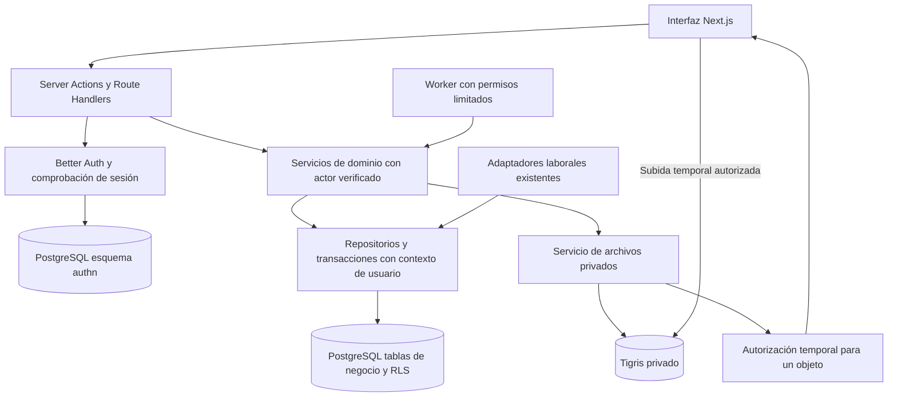

# Transición de arquitectura de BuscaVacante

Fecha: 6 de noviembre de 2026. Tarea 04. Base analizada: `8c1bfe4`, posterior al cierre del checkpoint reproducible.

## Decisión y alcance

Conservar Next.js 16, React, TypeScript, modelos de dominio, motores deterministas, adaptadores laborales y renderer de CV. Implementar el backend propio como módulos de servidor de la misma aplicación Next.js, con PostgreSQL, Better Auth y Tigris detrás de interfaces internas. No hace falta añadir otro framework HTTP para cumplir el documento.

Es el diseño para las siguientes entregas, no una migración ejecutada. No se han instalado paquetes, creado recursos, consultado usuarios reales, leído secretos, cambiado configuraciones de despliegue ni aplicado SQL. La especificación exige RT-04 a RT-07; este plan define cómo llegar a ellos conservando el trabajo actual. Las brechas funcionales de la matriz continúan abiertas hasta su implementación y aceptación.

PostgreSQL 17 será la versión objetivo inicial: coincide con `supabase/config.toml` y satisface el mínimo 16 del PDF. La versión efectiva remota no se ha verificado. El proveedor de PostgreSQL, región y capacidad se decidirán antes de aprovisionar; no se compromete gasto ni plataforma nueva en esta tarea.

## Arquitectura destino



Las páginas y acciones invocarán servicios internos directamente. Los Route Handlers se reservan para Better Auth, subida/finalización/descarga y entradas HTTP necesarias. No se harán llamadas HTTP de una página de servidor a su propia API para acceder al dominio.

El worker ejecutará tareas largas, verificación de archivos e ingesta con control de concurrencia. No será fuente de verdad: PostgreSQL conservará tareas, estados e idempotencia. El producto concreto de ejecución se elegirá al implementar scheduling; no se añaden Redis, colas externas ni un motor de workflows por anticipado.

## Inventario de dependencias actuales

El [inventario estático](current-dependencies.json) registra 22 migraciones, 22 tablas declaradas, 34 nombres de funciones públicas y 42 módulos con imports Supabase o llamadas RPC. Incluye llamadas dinámicas conocidas. Es evidencia del repositorio, no una inspección del esquema vivo; las funciones redefinidas en varias migraciones se cuentan una sola vez por nombre.

| Área | Puntos actuales | Sustitución |
| --- | --- | --- |
| Sesión y cuenta | `lib/supabase/server.ts`, `lib/supabase/browser.ts`, `proxy.ts`, `app/actions/auth.ts` | `lib/auth/server.ts`, configuración Better Auth y cliente de autenticación; sesión validada en cada entrada protegida. |
| Consultas de páginas | Rutas privadas de búsquedas, jobs, CV y candidaturas | Read models desde servicios/repositorios autorizados; sin clientes Supabase en páginas. |
| Onboarding | `lib/onboarding/*.server.ts`, `lib/resumes/contextual-onboarding.server.ts`, acciones | Servicios de perfil, búsqueda y CV dentro de transacciones. |
| Catálogo y fuentes | `lib/job-sources/*repository*`, `source-registry.server.ts`, `public-catalog.server.ts` | Repositorios PostgreSQL que mantengan `JobOfferRepository`; lector público con campos permitidos. |
| Matching | `lib/matching/supabase-repository.server.ts` | Implementación PostgreSQL de `MatchingRepository` ligada a un actor. Mantener `engine.ts`. |
| Evidencia y borradores | `lib/applications/*.server.ts`, `app/actions/requirement-confirmations.ts` | Repositorios de evidencia/borrador con validación de propietario y CV confirmado. |
| CV derivados y descarga | `lib/derived-resumes/service.server.ts`, `app/api/derived-resumes/[id]/route.ts` | Servicio de documentos más adaptador Tigris; conservar selección factual, renderizado y hash. |
| Motor de candidatura | `lib/application-engine/service.server.ts` y acciones | Persistencia PostgreSQL y seguimiento manual; no activar conectores de envío automático. |
| Subida de navegador | `components/resume-uploader.tsx` usa Supabase Storage directamente | Ticket temporal emitido por backend, staging privado, validación y finalización idempotente. |

Se reutilizan `lib/matching/engine.ts`, normalización/canonicalización, adaptadores ATS, tipos de dominio, lógica de requisitos, selección de evidencias, contenido/renderizado de CV y componentes visuales. La sustitución de infraestructura no debe recalibrar relevancia, rediseñar BV-01 ni cambiar puntuaciones históricas.

## Capas y contratos internos

Distribución propuesta, respetando `app/`, `components/` y `lib/` actuales:

```text
lib/auth/                 Better Auth, sesión y estado de cuenta
lib/server/context.ts     ActorContext obtenido exclusivamente en servidor
lib/server/db/            Pool, transacciones, roles y repositorios PostgreSQL
lib/server/storage/       Interfaz de objetos y adaptador Tigris
lib/server/services/      Casos de uso de cuenta, perfiles, CV y búsquedas
lib/server/jobs/          Procesos persistidos, leases, reintentos y reconciliación
db/migrations/            Nueva cadena portable de migraciones PostgreSQL
app/api/auth/[...all]/    Handlers Better Auth
app/api/resumes/          Tickets y finalización; rutas concretas en implementación
```

Los servicios actuales pueden conservar su carpeta cuando sea útil; las rutas propuestas no obligan a mover archivos sin necesidad. Todo módulo con acceso a secretos o credenciales será `server-only`.

| Contrato | Responsabilidad |
| --- | --- |
| `SessionService.requireActor()` | Validar sesión y cuenta habilitada. Devuelve UUID, sesión, contexto de auditoría y permisos consultados en servidor. No recibe user_id del formulario como identidad. |
| `UnitOfWork.withActor(actor, operation)` | Una conexión y una transacción; instala contexto de usuario solo dentro de ella, ejecuta repositorios y hace commit/rollback antes de liberar la conexión. |
| `ProfileService.ensureOwnProfile(actor)` | Crear de forma idempotente el perfil de aplicación del actor si aún no existe. No deducir permisos de metadata editable. |
| Repositorios de búsqueda/matching/evidencia | Validar que UUID de perfil, búsqueda, CV, borrador y oferta pertenecen al contexto autorizado. Mantener versiones, FKs compuestas e índices únicos. |
| `PrivateObjectStore` | `put/get/head/delete/presign` con locators internos, timeout y errores tipados; sin conocimiento de candidato ni decisión de autorización. |
| `ResumeService` y `DocumentService` | Autorización, estados, hashes y relación DB/objeto. Nunca aceptar una URL arbitraria del cliente para descargar un CV. |
| `JobRunner` | Recuperar una tarea persistida, verificar propietario/estado actual y ejecutar una operación idempotente con permisos mínimos. |

Los nuevos paquetes previstos son `pg`, `@types/pg` para desarrollo, `better-auth`, `@aws-sdk/client-s3` y `@aws-sdk/s3-request-presigner`. Se verificarán y fijarán versiones estables compatibles al instalarlos. No se añade un ORM de negocio: SQL parametrizado y migraciones explícitas aprovechan el modelo actual. Better Auth admite conexión con `pg.Pool` mediante su integración PostgreSQL. [Fuente oficial](https://better-auth.com/docs/adapters/postgresql).

## PostgreSQL y autorización

### Distribución de tablas

Conservar nombres e identificadores de las tablas de negocio en `public` para reducir cambios, sin exponer PostgREST/Data API en destino. Usar un esquema separado `authn` para las tablas generadas de Better Auth y `app` para funciones internas de contexto. Los nombres y columnas de autenticación se generarán desde la configuración de la versión fijada; no se copiarán supuestos de una versión distinta.

| Grupo | Tablas de negocio que se conservan |
| --- | --- |
| Identidad profesional | `profiles`, `candidate_profiles` |
| Búsquedas y preferencias | `search_profiles`, `job_preferences` |
| Catálogo neutral | `companies`, `company_career_sources`, `job_sources`, `job_offers`, `job_offer_sources` |
| CV y extracción | `resumes`, `resume_extractions`, `derived_resumes` |
| Evidencia | `professional_evidence_profiles`, `professional_evidence_items`, `professional_evidence_urls` |
| Evaluación y candidatura | `job_matches`, `application_drafts`, `applications`, `application_answers`, `application_events`, `application_user_settings`, `user_application_answers` |

Añadir en migraciones futuras el registro de tareas/outbox, locators de almacenamiento y control de importación. No renombrar estados de negocio ni regenerar documentos durante la copia; los seis estados requeridos por RF-24 se resolverán en su tarea funcional con conversión explícita del legado.

### Roles y aislamiento

| Rol destino | Acceso previsto |
| --- | --- |
| Propietario/migrador | DDL e importación controlada; credencial fuera del runtime. |
| Autenticación | CRUD necesario en `authn`; sin lectura de CV ni credenciales de Tigris. |
| Aplicación privada | Tablas de negocio con RLS y contexto verificado; sin DDL, BYPASSRLS, TRUNCATE ni acceso general a credenciales de identidad. |
| Lector de catálogo | Vista o consultas con lista de columnas públicas; sin datos de candidato, raw payload ni estados personales. |
| Ingesta | Escritura de catálogo y salud de fuentes; sin CV/perfiles privados. |
| Worker de candidato | Operaciones acotadas por tarea y propietario; no reutilizar un superusuario como sustituto de service_role. |

Mantener RLS y FORCE RLS en tablas privadas, reemplazando roles `authenticated` y predicados `auth.uid()` por el rol propio y `app.current_user_id()`. Para `profiles`, la propiedad es `id`; para sus hijos, `user_id`. Incluir USING y WITH CHECK. Las credenciales del runtime no serán propietarias de tablas ni tendrán BYPASSRLS: esos privilegios pueden omitir RLS. [Comportamiento PostgreSQL](https://www.postgresql.org/docs/16/ddl-rowsecurity.html).

`app.current_user_id()` leerá contexto transaccional que el backend instala después de validar una sesión. Sin contexto devuelve NULL y las políticas deniegan. Nunca crear un endpoint que permita seleccionar el usuario del contexto ni concatenar SQL con valores recibidos.

Secuencia conceptual de cada unidad de trabajo: obtener conexión del pool, BEGIN, `set_config('app.user_id', actorId, true)` parametrizado, consultas, COMMIT; ante fallo ROLLBACK y liberación. No usar `pool.query` para consultas pertenecientes a esa transacción. Se necesita el mismo cliente durante toda la operación. [Transacciones node-postgres](https://node-postgres.com/features/transactions).

No mantener contexto en variables globales ni usar SET de sesión persistente. Probar alternancia A/B sobre la misma conexión, rollback, excepciones y concurrencia. Limitar pool y timeouts según capacidad del proveedor; conexiones de migración separadas. La caché pública puede compartirse; ninguna caché global de sesión/perfil/documentos puede reutilizar datos entre usuarios.

### Transformación de las funciones actuales

La tabla clasifica los 34 nombres del inventario. No se traducen SECURITY DEFINER ni grants por sustitución textual.

| Funciones actuales | Tratamiento destino |
| --- | --- |
| `calculate_search_next_run`, `jsonb_text_array`, `job_offer_matching_fingerprint`, `set_updated_at` | Reutilizar SQL portable tras revisar funciones, search_path y permisos. |
| `set_resume_lifecycle_timestamps`, `validate_job_preferences_version`, `guard_derived_resume`, `guard_application_derived_resume` | Mantener invariantes como constraints/triggers internos, adaptando contexto y locators sin llamadas a Storage. |
| `create_profile_for_auth_user` | Retirar dependencia del trigger sobre `auth.users`; `ensureOwnProfile` idempotente en primera operación privada con sesión válida. `profiles.id` referencia el UUID de identidad destino. |
| `guard_derived_storage` | Sustituir trigger de `storage.objects` por servicio de documentos y verificación de objeto; no importar esquema interno de Storage. |
| `create_resume_upload`, `complete_resume_upload`, `reject_resume_upload`, `approve_resume`, `archive_resume`, `soft_delete_resume` | Casos de uso transaccionales y estados de subida. Mantener dedupe, versión y único CV aprobado; aprobación de archivo no equivale a confirmación de extracción. |
| `ensure_contextual_candidate_profile`, `save_search_profile`, `transition_search_profile_status` | Servicios con locks equivalentes, propiedad y persistencia atómica de búsqueda/preferencias. |
| `find_existing_job_offer`, `find_existing_job_offers_batch`, `ingest_job_offer`, `ingest_company_career_job_offer`, `ingest_company_career_job_offers_batch`, `record_company_career_source_check` | Repositorio neutral de ingesta con transacciones, idempotencia y rol propio. Conservar firmas semánticas y reporte parcial. |
| `upsert_job_match`, `upsert_job_matches_batch`, `inherit_job_match_user_status`, `set_job_match_status` | Repositorio ligado al actor y servicios de estado; conservar guardado/descarte y scoring_version. |
| `create_prepared_application`, `confirm_application_answer`, `set_application_draft_status`, `update_application_draft_text` | Servicios autorizados, auditoría, validación y transacciones. La edición de texto debe invalidar aprobación cuando corresponda. |
| `reserve_application_attempt` | Preservar datos históricos, pero no habilitar envío externo. El alcance inicial usa seguimiento manual; no reconstruir un auto-submit como parte de la migración. |

Las 22 migraciones de `supabase/migrations/` permanecen como historial del origen. El destino tendrá una nueva baseline SQL revisada en `db/migrations/`, sin recrear `auth`, `storage` ni grants Supabase. Generar y revisar el esquema Better Auth en una base aislada; no ejecutar su CLI de migración automática en producción. Importar datos con una herramienta idempotente y un manifiesto por lote, sin copiar secretos a Git.

## Better Auth y continuidad de cuentas

Montar Better Auth en `/api/auth/[...all]` con handlers Node.js y `lib/auth/server.ts`. Los RSC consultan sesión en servidor; las mutaciones pasan cookies correctamente desde handlers o Server Actions. La integración oficial contempla `nextCookies` para acciones y requiere validar las operaciones protegidas, aunque el proxy haga una redirección optimista por cookie. [Integración Next.js](https://better-auth.com/docs/integrations/next).

Decisiones de configuración para implementar y probar:

- IDs UUID en autenticación, conservando exactamente los UUID importados. Better Auth permite configurar generación UUID y nombres de tablas; comprobar DDL generado y tipos FK antes de importar. [Esquema y UUID](https://better-auth.com/docs/concepts/database).
- Sesiones persistidas en PostgreSQL, sin cookieCache al inicio, y validación de cuenta habilitada. Así el cierre global se comprueba en las siguientes peticiones, sin esperar a una cookie de datos en caché. [Sesiones y revocación](https://better-auth.com/docs/concepts/session-management).
- Contraseña de 12 a 128 caracteres; reset de máximo 900 segundos, de un uso, con revocación de sesiones tras reset. Confirmación por correo y respuestas uniformes para evitar enumeración. Las opciones de longitud y caducidad están documentadas; la unicidad del uso y concurrencia del reset se comprobarán en integración. [Opciones oficiales](https://better-auth.com/docs/reference/options).
- Email validado en servidor, máximo 254 caracteres y unicidad normalizada. No confiar solo en el input HTML. El límite se aplica también al endpoint público de autenticación, no únicamente al formulario propio.
- Cookies HttpOnly/Secure en producción, SameSite y trustedOrigins explícitos; callbacks de retorno limitados a destinos internos permitidos. Las acciones sensibles validan origen/CSRF además de sesión.

### Importación de identidad

1. Exportar a un almacén privado solo UUID, email y estado necesario de cuenta/verificación desde el origen, con controles de acceso. No se necesita importar contraseñas, refresh tokens ni sesiones.
2. Detectar colisiones de UUID y de email normalizado antes de crear identidad. No unir cuentas por coincidencia de email ni reactivar usuarios bloqueados/eliminados.
3. Crear registros de identidad preservando UUID, fechas y verificación únicamente si el origen la acredita. La asociación credential se preparará con un hash generado por la versión fijada de Better Auth sobre un secreto aleatorio efímero desconocido por el usuario; descartar ese secreto. Ensayar creación y reset de esa cuenta importada antes de usar datos reales.
4. Exigir recuperación para establecer contraseña propia en destino y nueva sesión. No suponer compatibilidad entre hashes Supabase y Better Auth. El envío real de avisos de migración es una acción de puesta en marcha separada; no se envía nada en esta tarea.
5. No importar sesiones ni aceptar JWT de Supabase como sesión Better Auth. El corte debe cerrar el acceso del sistema anterior y distinguir nombres de cookies.
6. Preservar `public.profiles.id` y sus relaciones al vincular el UUID nuevo. Nuevas cuentas crean el perfil de aplicación de forma idempotente al primer acceso privado; la ausencia temporal de ese perfil no otorga permisos.

Probar login/logout actual y global, reset expirado/usado/doble simultáneo, cuenta deshabilitada y email no verificado. No se habilita el corte si la recuperación de usuarios importados falla. Si el origen no contiene usuarios, verificar ese hecho y usar el recorrido de alta normal; este diseño no presupone volúmenes reales.

## Tigris y ciclo de archivos

Tigris ofrece API compatible con S3 y URLs temporales limitadas a objetos. Se usarán credenciales solo de servidor, buckets privados y permisos por entorno/operación. [Funciones de almacenamiento oficiales](https://www.tigrisdata.com/features/).

Dos colecciones lógicas, CV originales y documentos derivados, con nombres físicos por entorno. Conservar los IDs, versiones y rutas generadas del dominio; añadir un locator interno que relacione cada documento con provider, bucket y key reales. No cambiar una columna GENERATED para introducir una ruta manual ni usar el nombre original como clave autorizable.

### Subida nueva

1. Backend valida sesión, propiedad del perfil, extensión/MIME declarados, tamaño, cuota e idempotency key. Crea metadata y un objeto staging aleatorio ligado a ese usuario y CV.
2. Emite autorización PUT corta, propuesta de 5 minutos, exclusivamente para ese staging. No concede claves de API, listado ni escritura sobre objetos finales. CORS limitado a orígenes propios. Verificar en el SDK elegido qué headers y restricciones de tamaño pueden firmarse; no confiar en declaraciones del navegador.
3. Navegador sube directamente a Tigris y llama a finalizar. Esto evita transportar 10 MB en el body de una función HTTP: Vercel documenta 4,5 MB para payload de petición/respuesta. Es una condición del alojamiento si se usa Vercel, no una obligación de cambiar de proveedor. [Límites oficiales](https://vercel.com/docs/functions/limitations).
4. Backend/worker recupera el staging desde Tigris, con lectura acotada, valida tamaño real, firma de archivo, parseo y SHA-256. El hash aportado por cliente es solo una expectativa. No usar ETag como prueba SHA-256.
5. Guardar los mismos bytes ya verificados bajo una clave final nueva, de escritura exclusiva del backend. Evitar validar un staging y luego copiar su versión mutable sin fijarla: un PUT firmado podría repetirse entre ambas operaciones. Un archivo acotado puede verificarse y reemitirse desde un buffer propio; limitar concurrencia y memoria.
6. Confirmar metadata técnica READY mediante transición condicional y transacción. Finalizar dos veces devuelve el mismo resultado. No promover datos extraídos a evidencia confirmada por completar la subida.
7. Si falla DB u objeto, conservar estado explícito y tarea de reconciliación; borrar staging/huérfanos según política, sin borrar un original válido anterior. No mantener una transacción SQL abierta durante transferencias de red.

El límite del PDF se interpretará para nuevas cargas como 10.000.000 bytes, conservando la lectura de archivos históricos aceptados con el límite actual de 10 MiB. Esta distinción debe figurar en validación y copy de la tarea 08; nunca usar el cambio de unidad para descartar un archivo durante la copia. Un staging sobredimensionado se rechaza y elimina; cuotas, caducidad y límites de emisión evitan almacenamiento huérfano ilimitado.

### Lectura, copia y conservación

- Autorizar por ID del documento y actor, localizar el objeto en DB y emitir GET de duración corta, propuesta de 60 segundos. El origen no viene de una URL libre del cliente.
- La URL es una credencial temporal: no persistirla ni registrarla, responder con no-store y evitar caché pública. Revocar una sesión impide emitir nuevas URLs, pero una ya emitida puede vivir hasta su expiración; documentar esa ventana y usar proxy autenticado cuando se necesite revocación inmediata y el alojamiento soporte el tamaño.
- Importar desde `private-resumes` y `derived-resumes` leyendo objetos y calculando SHA-256 de los bytes; comparar tras escribir destino. No copiar únicamente metadata de `storage.objects` ni declarar éxito por tamaño coincidente.
- Registrar por lote ID de documento, locator origen/destino, bytes, hash y resultado en manifiesto privado. No guardar contenido, URLs firmadas ni datos personales en memoria del proyecto.
- Los objetos inmutables y derivados deben conservar integridad, fechas, estados y vínculo al CV base. Mantener un registro de eliminación/reconciliación que no reintroduzca archivos borrados durante una repetición de la migración.

La configuración exacta de endpoint/región, políticas, headers y comportamiento del SDK se validará con un bucket de prueba en la tarea 08. La documentación de features respalda la compatibilidad general, no sustituye esos contratos ejecutables.

## Estrategia de migración y corte

### Entregas preparatorias

| Fase | Tareas de checklist | Entrega y condición de salida |
| --- | --- | --- |
| M0 | 05 | CI con tipos, lint, pruebas, build y umbral de cobertura del negocio definido; sin credenciales de producción en CI. |
| M1 | 06 | Base PostgreSQL aislada, migraciones/roles/RLS y repositorios. Pruebas A/B, integridad y alternancia de conexión aprobadas. |
| M2 | 07 | Better Auth con esquema fijado, cookies, cuenta y recuperación. Usuario importado sintético recupera acceso conservando UUID; cierre global efectivo. |
| M3 | 08 | Tigris privado y flujo staging/finalización; copia y hashes, fallos DB/Storage y replay de subida probados. |
| M4 | 09 y 10 | Perfil e historial y datos extraídos revisables. Distinguir lo heredado de lo confirmado antes de nuevas evaluaciones/documentos. |
| M5 | Preproducción | Ensayo de importación completa, comparaciones y reversión con datos sintéticos/permitidos. Mismo modelo de roles y configuraciones que el destino. |
| M6 | Puesta en marcha separada | Corte controlado únicamente con los criterios de salida satisfechos, infraestructura configurada y autorización operativa correspondiente. |

La selección de adapters será de servidor y explícita. Durante desarrollo pueden convivir implementaciones detrás de contratos para comparar fixtures. En producción cada despliegue activo tiene un modo coherente LEGACY o TARGET para identidad, DB y archivos. No mezclar usuarios que escriben simultáneamente en bases distintas ni hacer fallback de datos privados al sistema antiguo después de un error. Las discrepancias se detectan y se falla de forma controlada.

### Secuencia de corte prevista

1. Aprovisionar destino aislado y comprobar respaldo/restauración. Mantener origen intacto. Preparar despliegues de legado y destino identificables por commit y contrato de schema.
2. Ensayar carga idempotente y crear un informe privado de reconciliación. Las credenciales/importadores no se ejecutan desde peticiones públicas.
3. Abrir ventana de mantenimiento. Detener ingesta, workers y operaciones privadas de escritura. Bloquear también las escrituras directas del navegador contra DB/Storage del legado; ocultar botones no es suficiente. Resolver o abortar explícitamente uploads en vuelo y comprobar ausencia de escritores.
4. Exportar el snapshot final consistente, importar identidad y tablas en orden FK, copiar/reconciliar objetos y verificar eliminaciones. Usar ID, conteos, digest de filas normalizadas y hashes de archivos; conteos iguales por sí solos no prueban integridad.
5. Validar restricciones/FKs, cero objetos privados sin propietario, cero hashes discrepantes, estados y referencias históricas conservados. Las cuentas eliminadas/bloqueadas siguen sin acceso.
6. Probar el destino aún en mantenimiento: login/recuperación, acceso cruzado denegado, CV y candidatura autorizados. Cambiar tráfico de forma coherente, invalidar acceso del legado y no reactivar sus jobs.
7. Habilitar escrituras TARGET solo tras comprobar los puntos anteriores. Desde ese instante, registrar en un journal/outbox de migración toda modificación y alta de objeto, además de las eliminaciones, hasta cerrar la ventana de reversión.
8. Supervisar errores, integridad, seguridad y colas. Retener origen en modo bloqueado y copias por un periodo definido con la política de retención; no fijar una retención indefinida ni borrar el origen como parte del cambio de tráfico.

### Datos profesionales heredados

Conservar las extracciones, borradores y scoring históricos como snapshots. La etiqueta heredada VERIFIED no acredita confirmación explícita si procede del bootstrap de un primer CV autoaprobado. Añadir procedencia y estado de reconfirmación para uso futuro sin reescribir evaluaciones anteriores. Los nuevos documentos solo usarán evidencia que satisfaga RF-05/RF-23. No regenerar CV ni ejecutar matching masivo como efecto lateral de importar datos.

## Reversión sin pérdida silenciosa

| Momento del fallo | Respuesta prevista |
| --- | --- |
| Antes del corte | Abortarlo; descartar o reparar el destino aislado, sin modificar el origen operativo. |
| Tráfico cambiado, TARGET aún sin escrituras | Mantener mantenimiento, devolver tráfico al despliegue de legado compatible y exigir sesión nueva. Reabrir solo después de comprobar origen y Storage. |
| TARGET ya recibió escrituras | No volver simplemente al despliegue anterior. Congelar escrituras, conservar TARGET y su journal, reconciliar delta y objetos hacia legado mediante procedimiento ensayado, o reparar TARGET. Cualquier caso no reversible mantiene mantenimiento y acceso de recuperación controlado. |
| Contraseñas/cuentas nuevas en TARGET | No copiar hashes Better Auth a Supabase ni asumir compatibilidad. La reversión de identidad debe preservar UUID y exigir nuevo reset en el sistema que vuelva a ser autoridad; ensayarlo antes de abrir escrituras. |
| Objetos creados/eliminados después del corte | Reconciliar bytes, hashes y tombstones. No resucitar un archivo eliminado ni perder documentos nuevos por restaurar solo una DB antigua. |

El journal, importador inverso y procedimientos de identidad son condiciones de aceptación de M5, no capacidades ya existentes. Si no se puede demostrar la conservación del delta, la opción de recuperación es corregir TARGET en mantenimiento; no prometer rollback inmediato con datos divergentes.

## Pruebas y criterios de aceptación de implementación

| Área | Casos obligatorios antes del corte |
| --- | --- |
| Contratos | Repositorios legado/destino producen el mismo resultado semántico sobre fixtures para normalización, persistencia, matching, CV y versiones. |
| Identidad | UUID conservado; email colisionado aborta; reset recupera importados; token expirado/reutilizado/concurrente rechazado; sesiones de dos dispositivos invalidadas al cerrar todas. |
| Aislamiento | A no lee/escribe/reasigna perfil, CV, búsqueda, evidencia, match, borrador ni documento de B; contexto ausente y cuenta bloqueada deniegan. |
| Pool | A/B alternados, error antes/después de set_config, rollback y concurrencia no filtran contexto ni dejan transacciones abiertas. |
| Privilegios | Runtime no puede DDL/TRUNCATE ni omitir RLS; lector público e ingesta no acceden a tablas privadas; soporte no obtiene privilegios por metadata de usuario. |
| Transacciones | Confirmación concurrente de CV, incremento de versión, guardado de preferencias y transición de estado conservan unicidad e historial. |
| Archivos | MIME/extensión/firma/tamaño/hash, PUT repetido antes/después de finalizar, finalización duplicada, objetos faltantes/corruptos, URL caducada y descarga cruzada. |
| Fallos parciales | PUT correcto/DB fallida, DB correcta/objeto fallido, reintentos y tareas huérfanas convergen sin pérdida del CV anterior ni aprobación de datos sin confirmar. |
| Migración | Reejecutar no duplica; integridad FK y digest por filas; bytes/hashes coinciden; eliminaciones, procedencia y snapshots se preservan. |
| Reversión | Ensayos antes y después de escrituras TARGET, incluyendo usuario nuevo, cambio de contraseña, documento nuevo y eliminación. |
| Operación | Tipos, lint, tests, build; conectividad, SMTP, TLS, entornos separados, backup/restauración, rate limits y métricas de latencia con carga acordada. |

La suite actual de 377 pruebas aprobadas y 15 omitidas es la línea base, no evidencia de que estas pruebas nuevas ya estén implementadas. Este plan no cambia esa clasificación.

## Decisiones pendientes de infraestructura

Se resolverán cuando condicionen una implementación concreta: proveedor/región/plan PostgreSQL, canal SMTP, buckets/endpoints Tigris y residencia de datos, ejecución de worker, capacidad de pool, volumen real y ventana de mantenimiento. No hace falta conocerlos para escribir contratos y pruebas sintéticas; sí antes de aprovisionar, probar proveedores o programar el corte.

## Salida de la tarea 04

- Inventario local reproducible y todos los nombres de tablas/funciones clasificados.
- Arquitectura destino y límites de autorización, almacenamiento e identidad definidos.
- Secuencia, invariantes, pruebas y reversión descritos, sin afirmar ejecución remota.
- Contexto/memoria alineados con el diseño y con lo que sigue funcionando hoy.
- Próxima tarea: 05, configurar controles automáticos de integración antes de implementar M1.

Las páginas oficiales enlazadas se consultaron el 6 de noviembre de 2026. Revalidar APIs y versiones al implementar; este diseño no exige instalar versiones beta ni ejecutar comandos `latest` sobre producción.
